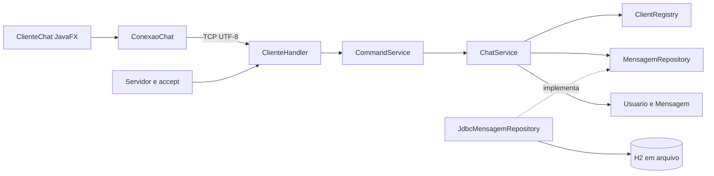

# Arquitetura e tratamento da concorrência

O Conexo separa a interface, o transporte TCP, as regras e a persistência. O servidor ordena a gravação das mensagens públicas antes de publicá-las aos clientes, mantendo o histórico coerente com a ordem vista na conversa.

## Organização

| Pacote | Responsabilidade |
| --- | --- |
| `model` | Usuário e mensagem imutáveis, validações e formatação |
| `persistence` | Contrato do histórico e exceção independente de JDBC |
| `persistence.jdbc` | SQL, conexões por operação e tradução de erros |
| `service` | Regras, comandos, participantes, publicação e mensagens privadas |
| `server` | Escuta TCP, handshake, leitura limitada e filas de saída |
| `protocol` | Tipos de evento e codificação compartilhada, sem sockets ou SQL |
| `client` | Conexão do cliente e interface JavaFX |
| `config` | Configuração externa com valores padrão |

`Servidor.main` monta as implementações e injeta as dependências. O cliente não conhece os serviços ou o banco. Serviços não importam `java.net` ou `java.sql`. O protocolo tem pacote próprio porque é compartilhado pelos dois lados. Essa é uma adaptação deliberada da sugestão de manter Protocolo em server no DOCX.

## Fluxo público

1. O cliente envia uma linha; uma thread de rede a entrega ao handler.
2. `CommandService` distingue comando de conteúdo público.
3. `ChatService` cria e valida `Mensagem` usando um `Clock` recebido no construtor.
4. O repository salva e devolve uma nova instância com ID gerado.
5. O serviço publica o evento para um snapshot dos participantes.
6. Cada handler coloca o evento em sua fila; a thread de saída desse cliente escreve no socket.
7. A thread de rede do cliente recebe o evento; `Platform.runLater` atualiza a interface.

O remetente recebe o evento persistido do próprio servidor, evitando desenhar uma mensagem pública antes da gravação. Isso confirma a aceitação pelo servidor, mas não garante que todos os destinatários a tenham recebido ou lido. Falhas de banco geram erro ao remetente e impedem a publicação.

## Estado compartilhado e proteção

| Recurso | Proteção e justificativa |
| --- | --- |
| Lista de clientes | Métodos sincronizados no registry; snapshot imutável para publicação |
| Reserva do apelido | Verificação e inclusão no mesmo lock, evitando duas entradas com o mesmo nome |
| Gravação e publicação | Métodos sincronizados no ChatService, mantendo uma ordem única |
| Histórico inicial e novas mensagens | Mesmo lock do serviço; histórico enfileirado antes de novas mensagens para a conexão |
| Escrita no socket de cada cliente | Uma única thread escritora, com fila FIFO limitada a 256 eventos |
| Conexão JDBC | Uma nova conexão por operação, sem compartilhamento entre threads |
| Interface | Apenas a thread do JavaFX altera componentes |
| Encerramento do cliente gráfico | AtomicBoolean permite fechar uma vez e descartar callbacks de sessões anteriores |

A sincronização do serviço serializa o acesso ao banco: uma operação lenta de persistência atrasa novos envios e entradas. Essa escolha simplifica a demonstração de ordenação no trabalho. A publicação apenas enfileira eventos, sem esperar I/O de socket, então um cliente lento não mantém esse lock preso. Se a fila encher, somente esse cliente é desconectado e poderá recuperar o histórico público ao retornar.

Cada conexão possui uma thread leitora `ClienteHandler` e uma thread escritora auxiliar. O requisito de uma thread dedicada por conexão permanece atendido; a auxiliar evita que a escrita de um cliente lento trave os demais. Ambas são finalizadas quando o socket fecha. O servidor mantém uma thread adicional para `accept`.

## Conexão e encerramento

O handshake tem limite de 30 caracteres e prazo de 10 segundos. O apelido aceita letras, números, espaços, hífen e sublinhado, até 30 caracteres após a normalização. Espaços nas pontas são removidos e espaços repetidos viram um só. A interface reutiliza a validação de Usuario e envia o apelido já normalizado. A lista recusa duplicatas desconsiderando maiúsculas por uma forma normalizada. Após o handshake, a leitura tem prazo de 90 segundos; o cliente envia ping a cada 25 segundos.

O comando privado aceita `/msg "Nome com espaços" mensagem` e mantém `/msg apelido mensagem` para nomes sem espaços. A interface sempre coloca o destinatário entre aspas ao montar o comando, evitando confusão entre apelidos como Ana e Ana Silva.

Linhas de requisição têm limite de 2048 caracteres. O servidor limita conexões simultâneas e isola falhas no handler. Quando cheio, fecha novas conexões; uma mensagem específica de capacidade é melhoria futura. Desconexão normal, quebra de rede, estouro da fila ou encerramento do servidor fecham os sockets e retiram o participante do registry.

O encerramento do servidor fecha a escuta e os sockets ativos. A gravação de cada mensagem pública já foi concluída antes de sua publicação; não há fila assíncrona de persistência a drenar. O usuário recebe aviso de conexão interrompida e pode sair e conectar novamente.

## Persistência e privacidade

H2 fica em `data/chat.mv.db`. A tabela `mensagem` contém ID sequencial, remetente, conteúdo e horário atribuído pelo servidor. O script usa identity e índice temporal. Buscas ordenam por ID, selecionam as últimas N e devolvem ordem cronológica. Os parâmetros usam `PreparedStatement`; o script fixo de criação usa `Statement` porque não recebe entrada do usuário.

A busca textual usa `LOCATE` com parâmetro; %, _ e aspas são literais. Avisos e digitação não ficam no banco. Privadas passam somente entre origem e destino conectados e não aparecem no histórico. A base não implementa contas, reserva persistente de apelidos ou criptografia TCP.

## Validação

Os testes de domínio, serviço e protocolo não abrem rede nem banco real. O serviço recebe repository em memória e conexões falsas. Há testes concorrentes com latch e futures para apelido único e 60 envios preservando ordem. Falha de banco não publica; falha de destinatário não interrompe os demais.

Testes de integração cobrem H2, reabertura do arquivo, busca literal e servidor real em porta aleatória com três clientes. A interface é conferida separadamente em execução; isso não substitui futuros testes automatizados de acessibilidade e interação.
