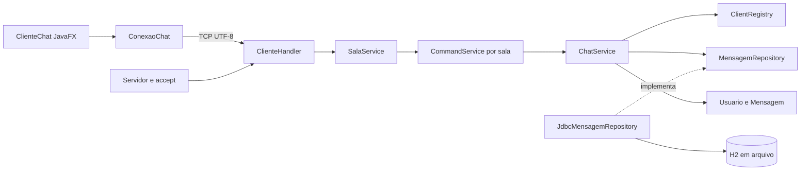

# Arquitetura e tratamento da concorrência

O Conexo separa a interface, o transporte TCP, as regras e a persistência. O servidor ordena a gravação das mensagens públicas antes de publicá-las aos clientes, mantendo o histórico coerente com a ordem vista na conversa.

## Organização

| Pacote | Responsabilidade |
| --- | --- |
| `model` | Usuário e mensagem imutáveis, validações e formatação |
| `persistence` | Contrato do histórico e exceção independente de JDBC |
| `persistence.jdbc` | SQL, conexões por operação e tradução de erros |
| `service` | Coordenação de salas, regras, comandos, participantes, publicação e mensagens privadas |
| `server` | Escuta TCP, handshake, leitura limitada e filas de saída |
| `protocol` | Tipos de evento e codificação compartilhada, sem sockets ou SQL |
| `client` | Conexão do cliente e interface JavaFX |
| `config` | Configuração externa com valores padrão |

`Servidor.main` monta as implementações e injeta as dependências. O cliente não conhece os serviços ou o banco. Serviços não importam `java.net` ou `java.sql`. O protocolo tem pacote próprio porque é compartilhado pelos dois lados. Essa é uma adaptação deliberada da sugestão de manter Protocolo em server no DOCX.

`SalaService` coordena as conversas no mesmo socket de escuta. O padrão é Geral, Estudos, Projetos, Café e Livre; `server.rooms` permite configurar de 1 a 20 salas. Cada sala possui seu próprio `ChatService`, `ClientRegistry`, `CommandService` e repository JDBC com filtro fixo de sala. O IP e a porta são compartilhados; o identificador de sala define a conversa. Não há criação de IPs adicionais nem varredura da rede.

`Config` lê `chat.properties` em UTF-8, aceita BOM e valida identificadores únicos, limites e a presença do identificador inicial `geral`. Alterar apenas o nome exibido preserva a associação ao histórico. Retirar uma sala da configuração não apaga suas mensagens; reintroduzir o mesmo identificador recupera o conteúdo. A configuração é aplicada ao reiniciar o servidor.

A apresentação visual combina Primer Light e Primer Dark do AtlantaFX 2.0.1 com a paleta Violeta suave do Conexo. `Temas` aplica Roxo (padrão), Claro e Escuro sem reconstruir a conversa e salva apenas a preferência local em `cliente.properties`. `PopupIdentidade` exige a escolha explícita de um dos 18 emojis; `EmojiAvatar` usa PNGs 3D locais com brilho, sem depender das fontes do computador. `client.Icones` centraliza os ícones Feather do Ikonli 12.4.0 e preserva a fonte do pacote ao ajustar os tamanhos. `client.Animacoes` combina fades do AnimateFX 1.3.0 com transições nativas do JavaFX para telas, ilustração, botões, envio e novas mensagens. As animações permanecem sempre ativas e rodam na thread do JavaFX. Efeitos contínuos e transitórios são interrompidos ao sair ou trocar de tela; os controles descartados não ficam retidos pelo registro de interações.

`client.AnimacaoJanela` controla separadamente a opacidade do `Stage` e um pequeno deslocamento do conteúdo. A transparência é definida antes de `show()`, com CSS e layout preparados; um `AnimationTimer` de um pulso agenda a abertura de 850 ms. A primeira tela não executa fades concorrentes de tela e formulário. A saída de 300 ms parte dos valores atuais, inclusive durante a abertura, e não altera tamanho, posição ou escala da janela. Moldura e conteúdo desaparecem juntos. Solicitações repetidas de fechar não reiniciam a transição nem executam a finalização novamente.

Ao fechar, a interface consome novos eventos de entrada e ignora callbacks da sessão, fecha a conexão e congela efeitos, timers e rascunhos no último quadro. Os controles não são desabilitados visualmente nem os balões removidos antes do fade. `Platform.exit()` ocorre ao concluir a saída; `stop()` libera os componentes e cancela qualquer transição pendente. Trocar de sala não cancela a abertura da janela.

Histórico aparece em conjunto; novas mensagens entram individualmente. A troca substitui a tela anterior antes da entrada, evitando sobreposição de letras; botões respondem à pressão sem aumentar de tamanho ao passar o mouse. A rolagem suave agrupa atualizações do mesmo ciclo do JavaFX, respeita a leitura de mensagens antigas e oferece um atalho para voltar às novas mensagens. A tipografia usa mensagens de 16 px e campos de 15 px, com bolhas limitadas à largura da conversa.

O painel de apresentação ocupa a direita do `HBox` de entrada, com o formulário à esquerda. A conversa usa a região direita do `BorderPane` para salas, participantes e controles de conexão, mantendo o mesmo posicionamento lateral desde a inicialização.

`BalaoRascunho` mede o texto local e anima a largura e a altura da prévia, sem enviar o conteúdo à conexão. A prévia diferencia envio público e privado e não aparece para comandos. `BalaoDigitacao` mostra nome, avatar e pontos animados de um participante remoto. Há um temporizador separado por participante; mensagens, saída da sala e eventos de parada removem apenas o balão correspondente. Ao trocar de tela, timers e efeitos são encerrados.

O cliente envia `/typing` enquanto há atividade em um rascunho público e `/typing stop` ao parar, apagar, enviar, selecionar privado ou iniciar a troca de sala. O servidor transmite `DIGITANDO` com o nome e, para a parada, o segundo campo `stop`; nenhum evento contém texto do rascunho. O limite de frequência permite retomada imediata após uma parada. Digitação permanece isolada por sala e não é persistida. Os clientes devem ser atualizados junto com o servidor para interpretar a parada explícita.

Se um destinatário privado sair, a seleção permanece privada e avisa que a pessoa está offline, em vez de trocar automaticamente para envio público. A indicação **Salva no servidor** usa o evento público devolvido após a persistência, sem simular confirmação de leitura.

## Fluxo público

1. O cliente envia uma linha; uma thread de rede a entrega ao handler.
2. `CommandService` distingue comando de conteúdo público.
3. `ChatService` cria e valida `Mensagem` usando um `Clock` recebido no construtor.
4. O repository salva e devolve uma nova instância com ID gerado.
5. O serviço publica o evento para um snapshot dos participantes.
6. Cada handler coloca o evento em sua fila; a thread de saída desse cliente escreve no socket.
7. A thread de rede do cliente recebe o evento; `Platform.runLater` atualiza a interface.

O remetente recebe o evento persistido do próprio servidor, evitando desenhar uma mensagem pública antes da gravação. Isso confirma a aceitação pelo servidor, mas não garante que todos os destinatários a tenham recebido ou lido. Falhas de banco geram erro ao remetente e impedem a publicação.

## Estado compartilhado e proteção

| Recurso | Proteção e justificativa |
| --- | --- |
| Lista de clientes | Métodos sincronizados no registry; snapshot imutável para publicação |
| Sala de cada conexão | Mapa protegido pelo lock do SalaService; movimentos e roteamento são serializados |
| Reserva do apelido | Verificação e inclusão no mesmo lock, evitando duas entradas com o mesmo nome |
| Gravação e publicação | Métodos sincronizados no ChatService, mantendo uma ordem única |
| Histórico inicial e novas mensagens | Mesmo lock do serviço; histórico enfileirado antes de novas mensagens para a conexão |
| Escrita no socket de cada cliente | Uma única thread escritora, com fila FIFO limitada a 256 eventos |
| Conexão JDBC | Uma nova conexão por operação, sem compartilhamento entre threads |
| Interface | Apenas a thread do JavaFX altera componentes |
| Encerramento do cliente gráfico | AtomicBoolean permite fechar uma vez e descartar callbacks de sessões anteriores |

A sincronização do serviço serializa o acesso ao banco: uma operação lenta de persistência atrasa novos envios e entradas. Essa escolha simplifica a demonstração de ordenação no trabalho. A publicação apenas enfileira eventos, sem esperar I/O de socket, então um cliente lento não mantém esse lock preso. Se a fila encher, somente esse cliente é desconectado e poderá recuperar o histórico público ao retornar.

A coordenação de salas também usa uma seção crítica única para rotear mensagens e mover participantes. Isso evita que uma mensagem entre na sala errada durante a troca, com o custo de serializar as operações das salas. Uma gravação lenta pode atrasar as demais salas nesta versão. A entrada no destino é concluída antes da remoção da origem; se a leitura do histórico ou o apelido no destino falhar, a sala atual é preservada. A conexão TCP e sua thread leitora continuam as mesmas.

Cada conexão possui uma thread leitora `ClienteHandler` e uma thread escritora auxiliar. O requisito de uma thread dedicada por conexão permanece atendido; a auxiliar evita que a escrita de um cliente lento trave os demais. Ambas são finalizadas quando o socket fecha. O servidor mantém uma thread adicional para `accept`.

## Conexão e encerramento

O handshake tem limite de 256 caracteres e prazo de 10 segundos. A primeira linha é um evento `APRESENTACAO`, com dois campos Base64: apelido e identificador de emoji. Clientes antigos que enviam apenas o apelido, ou identificadores de emoji fora da lista permitida, são recusados. O apelido aceita letras, números, espaços, hífen e sublinhado, até 30 caracteres após a normalização. Espaços nas pontas são removidos e espaços repetidos viram um só. A interface reutiliza a validação de Usuario e envia o apelido normalizado com o emoji. Eventos `MENSAGEM` e `PRIVADA` carregam o emoji do remetente; `PERFIS` associa os participantes online aos seus emojis. Cada mensagem desenha o emoji armazenado naquele envio, independentemente de futuras mudanças do perfil. A coluna `emoji` é adicionada idempotentemente ao H2, com `smile` para o histórico anterior. A lista recusa duplicatas desconsiderando maiúsculas por uma forma normalizada. Após o handshake, a leitura tem prazo de 90 segundos; o cliente envia ping a cada 25 segundos.

O comando privado aceita `/msg "Nome com espaços" mensagem` e mantém `/msg apelido mensagem` para nomes sem espaços. A interface sempre coloca o destinatário entre aspas ao montar o comando, evitando confusão entre apelidos como Ana e Ana Silva.

Linhas de requisição têm limite de 2048 caracteres. O servidor limita conexões simultâneas e isola falhas no handler. Quando cheio, fecha novas conexões; uma mensagem específica de capacidade é melhoria futura. Desconexão normal, quebra de rede, estouro da fila ou encerramento do servidor fecham os sockets e retiram o participante do registry.

O encerramento do servidor fecha a escuta e os sockets ativos. A gravação de cada mensagem pública já foi concluída antes de sua publicação; não há fila assíncrona de persistência a drenar. O usuário recebe aviso de conexão interrompida e pode sair e conectar novamente.

## Persistência e privacidade

H2 fica em `data/chat.mv.db`. A tabela `mensagem` contém ID sequencial, remetente, conteúdo e horário atribuído pelo servidor. O script usa identity e índice temporal. Buscas ordenam por ID, selecionam as últimas N e devolvem ordem cronológica. Os parâmetros usam `PreparedStatement`; o script fixo de criação usa `Statement` porque não recebe entrada do usuário.

A coluna `sala` delimita o histórico e a busca. O ID permanece sequencial no banco inteiro, podendo ter intervalos no histórico de uma sala. A migração idempotente adiciona essa coluna a bancos antigos com valor padrão `geral`, preservando as mensagens existentes. Todas as consultas de conteúdo incluem o filtro da sala; há índice composto `(sala, id)`.

O comando `/limpar` registra em `ChatService` uma confirmação individual por conexão, válida por 30 segundos segundo o `Clock` do serviço. `/limpar confirmar` consome essa confirmação e chama `MensagemRepository.limpar()`, implementado em JDBC por `DELETE FROM mensagem WHERE sala = ?`. Não há reinício de IDs, exclusão de tabelas ou alteração do arquivo de configuração. `/limpar cancelar`, desconexão e troca de sala removem o pedido; uma limpeza concluída invalida outros pedidos anteriores da mesma sala.

A exclusão usa o mesmo lock da gravação e da publicação. Somente após o retorno do JDBC o serviço publica `HISTORICO_LIMPO`, com identificador e nome da sala, nome do solicitante e quantidade apagada. A fila de cada cliente preserva a ordem entre mensagens anteriores, evento de limpeza e mensagens novas. Falhas na exclusão não publicam sucesso. Não há autorização por cargo nesta versão; qualquer participante conectado pode confirmar a limpeza da própria sala.

O cliente marca as linhas públicas ao renderizar e remove somente essas linhas quando recebe `HISTORICO_LIMPO` da sala atual. Privadas em memória, rascunhos, participantes e conexão são mantidos; o conjunto de IDs visuais é limpo e um aviso informa quem executou a ação. Clientes e servidor precisam ser atualizados em conjunto para reconhecer o novo evento.

A busca textual usa `LOCATE` com parâmetro; %, _ e aspas são literais. Avisos e digitação não ficam no banco. Privadas passam somente entre origem e destino conectados e não aparecem no histórico. A base não implementa contas, reserva persistente de apelidos ou criptografia TCP.

## Validação

Os testes de domínio, serviço e protocolo não abrem rede nem banco real. O serviço recebe repository em memória e conexões falsas. Há testes concorrentes com latch e futures para apelido único e 60 envios preservando ordem. Falha de banco não publica; falha de destinatário não interrompe os demais.

Testes de integração cobrem H2, reabertura do arquivo, busca literal e servidor real em porta aleatória com três clientes. A interface é conferida separadamente em execução; isso não substitui futuros testes automatizados de acessibilidade e interação.

A suíte também cobre isolamento entre salas, troca na mesma conexão, contagens do catálogo, apelido ocupado no destino, movimentação concorrente com envios e migração de um banco sem a coluna de sala. O protocolo envia `SALAS` com a sala atual e as opções/contagens; `BEM_VINDO` informa a sala de entrada para a interface reconstruir a conversa e descartar a visualização anterior.

`protocol.ComandoChat` compartilha a interpretação de comandos entre cliente e serviços, incluindo aliases em português, maiúsculas e separadores de espaço copiados. A troca de sala tenta primeiro o identificador e depois o nome exibido, sem distinguir acentos ou maiúsculas; nomes ambíguos pedem o identificador. Respostas de comandos usam eventos `SISTEMA` com corpo e título em campos separados, exibidos em cartões privados ao solicitante. Avisos de entrada e saída continuam com um campo. Há testes de ponta a ponta para ajuda, listagem, troca, histórico, busca, privadas e saída pelo socket.

## Integração da IA

`SalaService` intercepta `/ia privado` e `/ia sala`. `AssistenteIA` executa HTTP fora do lock das salas, em dois workers, com no máximo seis consultas aceitas, uma pendente por conexão e intervalo de dez segundos. A pergunta pública é persistida antes do agendamento; a privada não é gravada. O resultado é roteado de volta sob o lock da central e só vale para a conexão e sala de origem. Troca de sala ou desconexão cancela o pedido. A versão do histórico impede publicar uma resposta antiga após `/limpar confirmar`.

`ClienteGroq` usa Java HttpClient e Gson 2.13.2. Envia somente instrução fixa e pergunta, com a chave exclusivamente no cabeçalho HTTP do servidor. Não segue redirecionamentos, limita o corpo recebido, aplica prazos e traduz erros sem expor credenciais ou respostas brutas de falha. Apenas `FalhaIA`, criada com mensagens públicas deliberadas, pode fornecer detalhes ao cliente. `ConfigIA` lê habilitação/modelo do arquivo e chave de `GROQ_API_KEY`; seu `toString()` oculta a chave.

`IA_DISPONIVEL` informa a configuração ao cliente. `IA_INICIO`, `IA_RESPOSTA` e `IA_ERRO` controlam o popup. A resposta privada vai só ao solicitante; a pública usa mensagens normais persistidas, com remetente reservado Conexo IA e emoji de robô. Respostas longas são divididas em partes de até 500 caracteres; controles de linha são convertidos em espaços para respeitar a validação de Mensagem. A API não recebe o histórico da sala. A configuração e os limites estão em [IA.md](IA.md).
