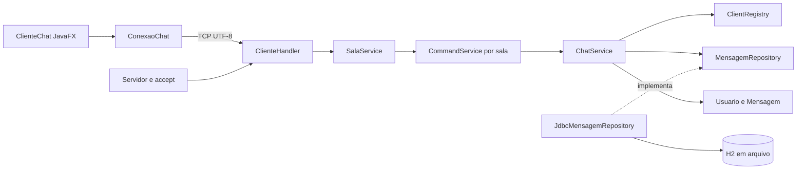

# Arquitetura e tratamento da concorrência

O Conexo separa a interface, o transporte TCP, as regras e a persistência. O servidor ordena a gravação das mensagens públicas antes de publicá-las aos clientes, mantendo o histórico coerente com a ordem vista na conversa.

## Organização

| Pacote | Responsabilidade |
| --- | --- |
| `model` | Usuário e mensagem imutáveis, validações e formatação |
| `persistence` | Contrato do histórico e exceção independente de JDBC |
| `persistence.jdbc` | SQL, conexões por operação e tradução de erros |
| `service` | Coordenação de salas, regras, comandos, participantes, publicação e mensagens privadas |
| `server` | Escuta TCP, handshake, leitura limitada e filas de saída |
| `protocol` | Tipos de evento e codificação compartilhada, sem sockets ou SQL |
| `client` | Conexão do cliente e interface JavaFX |
| `config` | Configuração externa com valores padrão |

`Servidor.main` monta as implementações e injeta as dependências. O cliente não conhece os serviços ou o banco. Serviços não importam `java.net` ou `java.sql`. O protocolo tem pacote próprio porque é compartilhado pelos dois lados. Essa é uma adaptação deliberada da sugestão de manter Protocolo em server no DOCX.

`SalaService` coordena as conversas no mesmo socket de escuta. O padrão é Geral, Estudos, Projetos, Café e Livre; `server.rooms` permite configurar de 1 a 20 salas. Cada sala possui seu próprio `ChatService`, `ClientRegistry`, `CommandService` e repository JDBC com filtro fixo de sala. O IP e a porta são compartilhados; o identificador de sala define a conversa. Não há criação de IPs adicionais nem varredura da rede.

`Config` lê `chat.properties` em UTF-8, aceita BOM e valida identificadores únicos, limites e a presença do identificador inicial `geral`. Alterar apenas o nome exibido preserva a associação ao histórico. Retirar uma sala da configuração não apaga suas mensagens; reintroduzir o mesmo identificador recupera o conteúdo. A configuração é aplicada ao reiniciar o servidor.

A apresentação visual combina Primer Light e Primer Dark do AtlantaFX 2.0.1 com a paleta Violeta suave do Conexo. `Temas` aplica Roxo (padrão), Claro e Escuro sem reconstruir a conversa e salva apenas a preferência local em `cliente.properties`. `PopupIdentidade` exige a escolha explícita de um dos 48 emojis e oferece busca sem distinção de acentos e filtros por categoria. A seleção permanece ativa ao filtrar a grade; `EmojiAvatar` usa PNGs 3D locais com brilho, sem depender das fontes do computador. `client.Icones` centraliza os ícones Feather do Ikonli 12.4.0 e preserva a fonte do pacote ao ajustar os tamanhos. `client.Animacoes` combina fades do AnimateFX 1.3.0 com transições nativas do JavaFX para telas, ilustração, botões, envio e novas mensagens. As animações permanecem sempre ativas e rodam na thread do JavaFX. Efeitos contínuos e transitórios são interrompidos ao sair ou trocar de tela; os controles descartados não ficam retidos pelo registro de interações.

`client.AnimacaoJanela` controla a opacidade do `Stage`, sem transladar o contêiner que cobre a janela; assim, as bordas permanecem preenchidas durante os fades. A troca entre telas também usa apenas opacidade no contêiner externo; animações internas das mensagens e ilustrações continuam com movimento. A transparência é definida antes de `show()`, com CSS e layout preparados; um `AnimationTimer` de um pulso agenda a abertura de 850 ms. A primeira tela não executa fades concorrentes de tela e formulário. A saída de 300 ms parte dos valores atuais, inclusive durante a abertura, e não altera tamanho, posição ou escala da janela. Moldura e conteúdo desaparecem juntos. Solicitações repetidas de fechar não reiniciam a transição nem executam a finalização novamente.

Ao fechar, a interface consome novos eventos de entrada e ignora callbacks da sessão, fecha a conexão e congela efeitos, timers e rascunhos no último quadro. Os controles não são desabilitados visualmente nem os balões removidos antes do fade. `Platform.exit()` ocorre ao concluir a saída; `stop()` libera os componentes e cancela qualquer transição pendente. Trocar de sala não cancela a abertura da janela.

Histórico aparece em conjunto; novas mensagens entram individualmente. A troca substitui a tela anterior antes da entrada, evitando sobreposição de letras; botões respondem à pressão sem aumentar de tamanho ao passar o mouse. A rolagem suave agrupa atualizações do mesmo ciclo do JavaFX, respeita a leitura de mensagens antigas e oferece um atalho para voltar às novas mensagens. A tipografia usa mensagens de 16 px e campos de 15 px, com bolhas limitadas à largura da conversa.

`MolduraJanela` usa `StageStyle.UNDECORATED`, fundo opaco e uma barra integrada ao tema; a faixa da direita acompanha o fundo e a largura do painel. Mantém minimizar, maximizar/restaurar, fechar, arrastar pela barra e duplo clique para maximizar. Oito áreas transparentes nas bordas e cantos implementam o redimensionamento sem desenhar faixas. O Stage tem limites mínimos zerados; a geometria impede dimensões negativas, e a própria janela recorta seus limites.

`DeslizeJanela` solicita maximização e restauração uma única vez pelas propriedades nativas do Stage. O estado dos controles acompanha os eventos reais do Windows. Essas operações não interpolam a geometria do Stage, evitando a disputa entre notificações nativas de tamanho e reorganização dos componentes.

Depois de duas passagens do JavaFX para o layout estabilizar, o conteúdo recebe um fade discreto de 0,96 para 1 por 160 ms. Não há translação ou escala da raiz. Ao minimizar pelo botão do aplicativo, a janela normal desliza 32 px para baixo e desaparece em 240 ms, antes de receber `setIconified(true)`. A posição é restaurada enquanto a janela está oculta; ao retornar, ela sobe 28 px e reaparece em 300 ms. Em estado maximizado, somente a opacidade é animada, sem escrever posição ou dimensões. As curvas usam interpolação suave. Novos cliques para minimizar não reiniciam a saída; arraste, redimensionamento e fechamento interrompem transições pendentes, sem executar callbacks antigos. A minimização iniciada pelo próprio Windows conserva o comportamento nativo. A alteração de geometria no início de um arraste da janela maximizada é uma interação direta do mouse, sem interpolação automática.

`ViewportAdaptavel` permite rolagem quando a janela fica menor que os controles. O login oculta a ilustração lateral abaixo de 940 px de largura ou 760 px de altura disponível. O formulário permanece acessível por rolagem e nunca impede o redimensionamento da janela. Na conversa, `TelaChatAdaptavel` mantém o painel à direita em larguras a partir de 880 px; abaixo disso, o botão Salas abre o mesmo painel sobre a conversa, com sombra e entrada animada. Clique fora ou Esc recolhe o painel. A lateral também pode rolar em alturas menores.

Abaixo de 620 px, busca e composição se reorganizam em linhas, sem reconstruir os campos. Abaixo de 420 px, ações auxiliares usam apenas ícones com nomes acessíveis e dicas. Em alturas reduzidas, legendas auxiliares cedem espaço à conversa. Rascunho, destinatário privado, mensagens e conexão são preservados ao atravessar os limites de layout. Dimensões menores que 300 × 400 px usam uma área virtual rolável; esse é o tamanho do conteúdo, não uma restrição ao Stage.

`SeletorTema` substitui o ComboBox por três ToggleButtons com estrela, sol e lua. Um destaque deslizante de 280 ms acompanha a opção escolhida; os ícones reagem ao mouse. A navegação por teclado e o nome acessível de cada tema são preservados. `Temas` sincroniza os seletores por referências fracas, aplica os mesmos tokens de cores anteriores e mantém a preferência local.

`BalaoRascunho` mede o texto local e anima a largura e a altura da prévia, sem enviar o conteúdo à conexão. A prévia diferencia envio público e privado e não aparece para comandos. `BalaoDigitacao` mostra nome, avatar e pontos animados de um participante remoto. Há um temporizador separado por participante; mensagens, saída da sala e eventos de parada removem apenas o balão correspondente. Ao trocar de tela, timers e efeitos são encerrados.

O cliente envia `/typing` enquanto há atividade em um rascunho público e `/typing stop` ao parar, apagar, enviar, selecionar privado ou iniciar a troca de sala. O servidor transmite `DIGITANDO` com o nome e, para a parada, o segundo campo `stop`; nenhum evento contém texto do rascunho. O limite de frequência permite retomada imediata após uma parada. Digitação permanece isolada por sala e não é persistida. Os clientes devem ser atualizados junto com o servidor para interpretar a parada explícita.

Se um destinatário privado sair, a seleção permanece privada e avisa que a pessoa está offline, em vez de trocar automaticamente para envio público. A indicação **Salva no servidor** usa o evento público devolvido após a persistência, sem simular confirmação de leitura.

## Fluxo público

1. O cliente envia uma linha; uma thread de rede a entrega ao handler.
2. `CommandService` distingue comando de conteúdo público.
3. `ChatService` cria e valida `Mensagem` usando um `Clock` recebido no construtor.
4. O repository salva e devolve uma nova instância com ID gerado.
5. O serviço publica o evento para um snapshot dos participantes.
6. Cada handler coloca o evento em sua fila; a thread de saída desse cliente escreve no socket.
7. A thread de rede do cliente recebe o evento; `Platform.runLater` atualiza a interface.

O remetente recebe o evento persistido do próprio servidor, evitando desenhar uma mensagem pública antes da gravação. Isso confirma a aceitação pelo servidor, mas não garante que todos os destinatários a tenham recebido ou lido. Falhas de banco geram erro ao remetente e impedem a publicação.

## Estado compartilhado e proteção

| Recurso | Proteção e justificativa |
| --- | --- |
| Lista de clientes | Métodos sincronizados no registry; snapshot imutável para publicação |
| Sala de cada conexão | Mapa protegido pelo lock do SalaService; movimentos e roteamento são serializados |
| Reserva do apelido | Verificação e inclusão no mesmo lock, evitando duas entradas com o mesmo nome |
| Gravação e publicação | Métodos sincronizados no ChatService, mantendo uma ordem única |
| Histórico inicial e novas mensagens | Mesmo lock do serviço; histórico enfileirado antes de novas mensagens para a conexão |
| Escrita no socket de cada cliente | Uma única thread escritora, com fila FIFO limitada a 512 eventos |
| Conexão JDBC | Uma nova conexão por operação, sem compartilhamento entre threads |
| Interface | Apenas a thread do JavaFX altera componentes |
| Encerramento do cliente gráfico | AtomicBoolean permite fechar uma vez e descartar callbacks de sessões anteriores |

A sincronização do serviço serializa o acesso ao banco: uma operação lenta de persistência atrasa novos envios e entradas. Essa escolha simplifica a demonstração de ordenação no trabalho. A publicação apenas enfileira eventos, sem esperar I/O de socket, então um cliente lento não mantém esse lock preso. Se a fila encher, somente esse cliente é desconectado e poderá recuperar o histórico público ao retornar.

A coordenação de salas também usa uma seção crítica única para rotear mensagens e mover participantes. Isso evita que uma mensagem entre na sala errada durante a troca, com o custo de serializar as operações das salas. Uma gravação lenta pode atrasar as demais salas nesta versão. A entrada no destino é concluída antes da remoção da origem; se a leitura do histórico ou o apelido no destino falhar, a sala atual é preservada. A conexão TCP e sua thread leitora continuam as mesmas.

Cada conexão possui uma thread leitora `ClienteHandler` e uma thread escritora auxiliar. O requisito de uma thread dedicada por conexão permanece atendido; a auxiliar evita que a escrita de um cliente lento trave os demais. Ambas são finalizadas quando o socket fecha. O servidor mantém uma thread adicional para `accept`.

## Conexão e encerramento

O handshake tem limite de 384 caracteres e prazo de 10 segundos. A primeira linha é um evento `APRESENTACAO`, com quatro campos Base64: apelido, identificador de emoji, UUID aleatório da sessão e identificador da sala desejada. O formato anterior de dois campos (apelido e emoji) ainda é aceito para testes e clientes sem retomada. Clientes antigos que enviam apenas o apelido, ou identificadores de emoji fora da lista permitida, são recusados. O apelido aceita letras, números, espaços, hífen e sublinhado, até 30 caracteres após a normalização. Espaços nas pontas são removidos e espaços repetidos viram um só. A interface reutiliza a validação de Usuario e envia o apelido normalizado com o emoji. Eventos `MENSAGEM` e `PRIVADA` carregam o emoji do remetente; `PERFIS` associa os participantes online aos seus emojis. Cada mensagem desenha o emoji armazenado naquele envio, independentemente de futuras mudanças do perfil. A coluna `emoji` é adicionada idempotentemente ao H2, com `smile` para o histórico anterior. A lista recusa duplicatas desconsiderando maiúsculas por uma forma normalizada. Após o handshake, a leitura tem prazo de 90 segundos; o cliente envia ping a cada 25 segundos.

O comando privado aceita `/msg "Nome com espaços" mensagem` e mantém `/msg apelido mensagem` para nomes sem espaços. A interface sempre coloca o destinatário entre aspas ao montar o comando, evitando confusão entre apelidos como Ana e Ana Silva.

Linhas de requisição têm limite de 2048 caracteres. O servidor limita conexões simultâneas e isola falhas no handler. Quando cheio, fecha novas conexões; uma mensagem específica de capacidade é melhoria futura. Desconexão normal, quebra de rede, estouro da fila ou encerramento do servidor fecham os sockets e retiram o participante do registry.

O encerramento do servidor fecha a escuta e os sockets ativos. A gravação de cada mensagem pública já foi concluída antes de sua publicação; não há fila assíncrona de persistência a drenar. Uma sessão já admitida recebe aviso de reconexão e tenta retornar automaticamente, com espera exponencial de 1 a 30 segundos. Falhas na primeira entrada ou recusa explícita do handshake encerram a tentativa e mostram o erro. Sair, `/quit` ou fechar cancela a reconexão, os sockets e o heartbeat.

## Persistência e privacidade

H2 fica em `data/chat.mv.db`. A tabela `mensagem` contém ID sequencial, remetente, conteúdo e horário atribuído pelo servidor. O script usa identity e índice temporal. Buscas ordenam por ID, selecionam as últimas N e devolvem ordem cronológica. Os parâmetros usam `PreparedStatement`; o script fixo de criação usa `Statement` porque não recebe entrada do usuário.

A coluna `sala` delimita o histórico e a busca. O ID permanece sequencial no banco inteiro, podendo ter intervalos no histórico de uma sala. A migração idempotente adiciona essa coluna a bancos antigos com valor padrão `geral`, preservando as mensagens existentes. Todas as consultas de conteúdo incluem o filtro da sala; há índice composto `(sala, id)`.

O comando `/limpar` registra em `ChatService` uma confirmação individual por conexão, válida por 30 segundos segundo o `Clock` do serviço. `/limpar confirmar` consome essa confirmação e chama `MensagemRepository.limpar()`, implementado em JDBC por `DELETE FROM mensagem WHERE sala = ?`. Não há reinício de IDs, exclusão de tabelas ou alteração do arquivo de configuração. `/limpar cancelar`, desconexão e troca de sala removem o pedido; uma limpeza concluída invalida outros pedidos anteriores da mesma sala.

A exclusão usa o mesmo lock da gravação e da publicação. Somente após o retorno do JDBC o serviço publica `HISTORICO_LIMPO`, com identificador e nome da sala, nome do solicitante e quantidade apagada. A fila de cada cliente preserva a ordem entre mensagens anteriores, evento de limpeza e mensagens novas. Falhas na exclusão não publicam sucesso. Não há autorização por cargo nesta versão; qualquer participante conectado pode confirmar a limpeza da própria sala.

O cliente marca as linhas públicas ao renderizar e remove somente essas linhas quando recebe `HISTORICO_LIMPO` da sala atual. Privadas em memória, rascunhos, participantes e conexão são mantidos; o conjunto de IDs visuais é limpo e um aviso informa quem executou a ação. Clientes e servidor precisam ser atualizados em conjunto para reconhecer o novo evento.

A busca textual usa `LOCATE` com parâmetro; %, _ e aspas são literais. Avisos e digitação não ficam no banco. Privadas passam somente entre origem e destino conectados e não aparecem no histórico. A base não implementa contas, reserva persistente de apelidos ou criptografia TCP.

## Validação

Os testes de domínio, serviço e protocolo não abrem rede nem banco real. O serviço recebe repository em memória e conexões falsas. Há testes concorrentes com latch e futures para apelido único e 60 envios preservando ordem. Falha de banco não publica; falha de destinatário não interrompe os demais.

Testes de integração cobrem H2, reabertura do arquivo, busca literal e servidor real em porta aleatória com três clientes. A interface é conferida separadamente em execução; isso não substitui futuros testes automatizados de acessibilidade e interação.

A suíte também cobre isolamento entre salas, troca na mesma conexão, contagens do catálogo, apelido ocupado no destino, movimentação concorrente com envios e migração de um banco sem a coluna de sala. O protocolo envia `SALAS` com a sala atual e as opções/contagens; `BEM_VINDO` informa a sala de entrada para a interface reconstruir a conversa e descartar a visualização anterior.

`protocol.ComandoChat` compartilha a interpretação de comandos entre cliente e serviços, incluindo aliases em português, maiúsculas e separadores de espaço copiados. A troca de sala tenta primeiro o identificador e depois o nome exibido, sem distinguir acentos ou maiúsculas; nomes ambíguos pedem o identificador. Respostas de comandos usam eventos `SISTEMA` com corpo e título em campos separados, exibidos em cartões privados ao solicitante. Avisos de entrada e saída continuam com um campo. Há testes de ponta a ponta para ajuda, listagem, troca, histórico, busca, privadas e saída pelo socket.

## Integração da IA

`SalaService` intercepta `/ia privado` e `/ia sala`. `AssistenteIA` executa HTTP fora do lock das salas, em dois workers, com no máximo seis consultas aceitas, uma pendente por conexão e intervalo de dez segundos. A pergunta pública é persistida antes do agendamento; a privada não é gravada. O resultado é roteado de volta sob o lock da central e só vale para a conexão e sala de origem. Troca de sala ou desconexão cancela o pedido. A versão do histórico impede publicar uma resposta antiga após `/limpar confirmar`.

`ClienteGroq` usa Java HttpClient e Gson 2.13.2. Envia somente instrução fixa e pergunta, com a chave exclusivamente no cabeçalho HTTP do servidor. Não segue redirecionamentos, limita o corpo recebido, aplica prazos e traduz erros sem expor credenciais ou respostas brutas de falha. Apenas `FalhaIA`, criada com mensagens públicas deliberadas, pode fornecer detalhes ao cliente. `ConfigIA` lê habilitação/modelo do arquivo e chave de `GROQ_API_KEY`; seu `toString()` oculta a chave.

`IA_DISPONIVEL` informa a configuração ao cliente. `IA_INICIO`, `IA_RESPOSTA` e `IA_ERRO` controlam o popup. A resposta privada vai só ao solicitante; a pública usa mensagens normais persistidas, com remetente reservado Conexo IA e emoji de robô. Respostas públicas são persistidas em uma única operação e transmitidas em um evento MENSAGEM, com o sexto campo `MARKDOWN_IA`. `Mensagem.respostaIA` cria esse formato reservado ao remetente Conexo IA com emoji de robô, aceita até 8.000 caracteres e preserva novas linhas e tabulações. O construtor existente mantém `TEXTO`, uma linha e 500 caracteres para participantes. `comId` preserva o formato. A codificação Base64 dos campos mantém o enquadramento de uma linha no socket mesmo com conteúdo multilinha. O limite de leitura de mensagens do cliente permanece inalterado.

A migração adiciona `formato VARCHAR(20) DEFAULT 'TEXTO' NOT NULL` e amplia `conteudo` para VARCHAR(8000). Histórico e busca reconstroem o tipo correto, sem converter conteúdo antigo nem remover mensagens. Respostas públicas novas são salvas integralmente antes do broadcast, sem cortes no meio de tabelas ou código.

`ConteudoMarkdown` usa CommonMark Java 0.32.0 com extensão GFM Tables e cria componentes JavaFX nativos: TextFlow para parágrafos e estilos, listas com marcadores, GridPane para tabelas com rolagem horizontal, TextArea somente leitura para código e contêineres para títulos/citações. Não usa WebView, não executa HTML e não carrega imagens remotas. A exibição da sala, o cartão privado e o popup compartilham o mesmo renderer e os tokens dos três temas. Botões de cópia preservam o texto original completo. Tabelas têm limite de células; falhas de análise usam texto simples como fallback. A API não recebe o histórico da sala. A configuração e os limites estão em [IA.md](IA.md).

## Chave da IA lembrada no Windows

`ConfigurarIA.cmd` chama `scripts/ConfigurarIA.ps1`, que solicita a chave como SecureString, valida o formato de entrada e a salva por `ConvertFrom-SecureString` sem chave explícita. No Windows isso usa DPAPI da conta. O arquivo `.local/ia/groq-key.dpapi` fica fora do controle de versão e da distribuição de fontes. Escritas usam arquivo temporário e substituição, sem guardar a chave em texto simples no projeto.

`scripts/ChaveIA.ps1` compartilha a gravação/leitura protegida e a habilitação da IA no arquivo de configuração, preservando salas, banco e modelo existentes. `scripts/Iniciar.ps1` importa a chave apenas no modo Servidor, imediatamente antes de iniciar o Java. Uma variável GROQ_API_KEY já fornecida à sessão tem prioridade; caso contrário, a chave local é decifrada e entregue ao processo do servidor por essa variável. Cliente, testes e preparação não carregam a credencial. Falhas de leitura orientam a reconfigurar e mantêm o chat disponível sem IA.

A validação usa uma chave fictícia em uma pasta temporária, incluindo leitura por um novo processo PowerShell sem variável herdada, preservação da configuração, prioridade da chave temporária e rejeição de um arquivo inválido. Nenhuma chave real é usada nesses testes.

## Interações públicas e retomada de sessão

`Mensagem` inclui `Citacao` opcional com ID, autor e resumo de até 180 caracteres. O cliente envia `/responder id texto`; o servidor busca o original pelo ID e sala, constrói a citação e só publica depois do commit. O banco guarda `resposta_id`; a leitura recupera autor e conteúdo da mensagem original, que já é um snapshot da identidade no envio. `MENSAGEM` acrescenta três campos após o formato: ID citado, autor e resumo (vazios sem citação). Privadas não recebem IDs públicos nem controles de reação, citação ou fixação.

A tabela `reacao` possui chave `(mensagem_id, participante, emoji)` e exclusão em cascata ao apagar a mensagem. A identidade da reação usa o UUID da sessão, preservado nas reconexões e na edição de perfil; clientes legados usam o apelido normalizado. `/reagir` alterna somente a reação do solicitante, com emoji da lista permitida. `REACOES` envia o ID e trios de emoji, contagem e flag de participação do destinatário; o servidor personaliza o evento para cada cliente. O histórico também envia o estado das reações. Novas entradas sem a sessão anterior podem reagir novamente, pois o aplicativo não possui autenticação de contas.

A coluna `fixada` marca mensagens públicas. `/fixar` e `/desfixar` verificam a sala; até cinco mensagens podem ficar fixadas simultaneamente. `FIXADAS` substitui a lista local com blocos de seis campos (ID, remetente, conteúdo, horário, emoji e formato). A interface mantém controles nas mensagens e um popup com os avisos completos, mesmo quando o original não está nas últimas mensagens carregadas. A limpeza do histórico remove citações, reações e fixações da sala e publica a lista vazia. Nesta versão, todos os participantes podem fixar e desafixar.

`Mencoes` reconhece `@apelido` e `@"Nome com espaços"`, sem confundir nomes parciais ou endereços de e-mail. Depois de persistir e transmitir uma mensagem pública, o servidor envia `MENCAO` somente aos destinatários online mencionados, excluindo o autor. Consultas de histórico e respostas automáticas da IA não geram alertas. O cliente destaca o balão, oferece aviso clicável e conta menções no título enquanto a janela está sem foco; recuperar o foco zera a contagem. O seletor **@** usa os participantes da sala.

`/perfil emoji apelido` valida o perfil e a unicidade no registry antes de alterar o `Usuario` imutável associado à conexão. A mudança cancela digitação e consultas de IA anteriores, publica `PERFIL_ALTERADO`, `USUARIOS` e `PERFIS` e atualiza os seletores privados. Mensagens persistidas mantêm o apelido e o emoji originais. `PopupIdentidade` reutiliza o seletor de 48 emojis e pré-seleciona a identidade atual na edição.

`ConexaoChat` mantém um canal com socket, fila e thread de saída por tentativa. Ao cair, fecha e descarta o canal inteiro antes de criar outro; nenhuma mensagem pendente é reenviada. O heartbeat só envia quando o handshake foi aceito. A última sala confirmada e o perfil confirmado são usados na retomada. `SalaService` pode substituir uma conexão antiga com o mesmo UUID, encerrando-a antes de admitir a nova; tokens nunca são enviados aos demais participantes. Se a sala tiver sido removida da configuração, usa Geral. A interface preserva rascunho, destinatário privado e citação da mesma sala durante a retomada; histórico público e avisos são recarregados. Mensagens privadas anteriores não são recuperadas do servidor.

`CatalogoComandos` é a fonte compartilhada da ajuda `/help` e de `AjudaComandos`. Digitar `/` abre a lista de comandos de uso público com descrições; prefixos filtram a lista, clique ou ↓/Enter preenche o campo e Esc recolhe. A seleção nunca executa o comando. `/ping` e `/typing` são controles internos da conexão, fora dessa lista.
